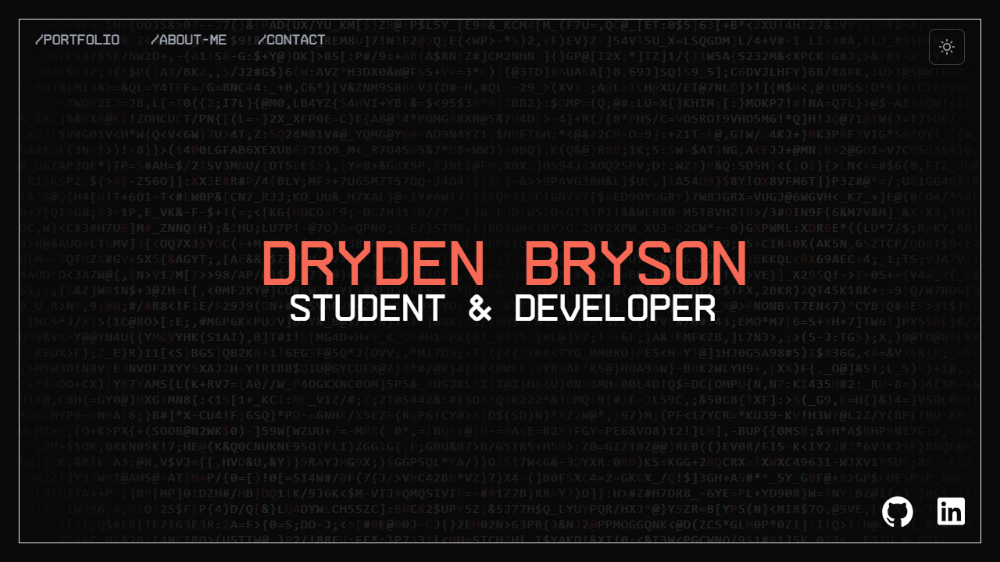
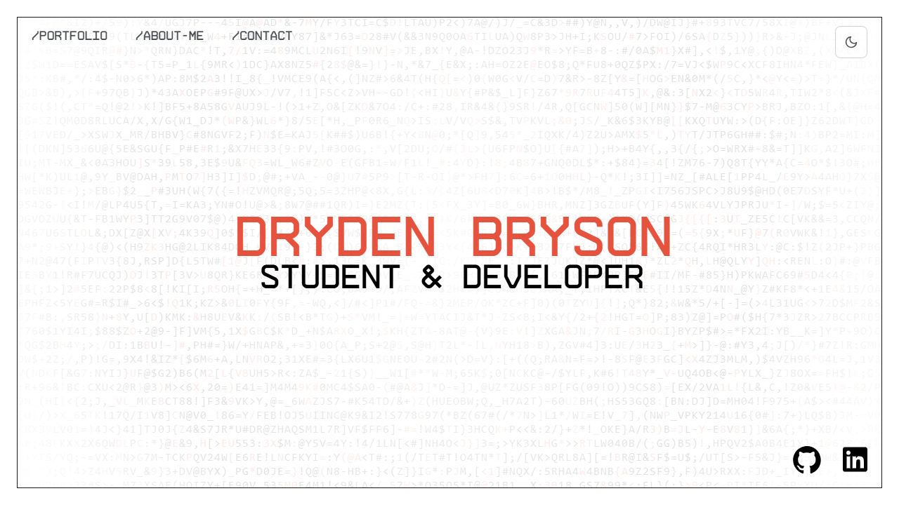
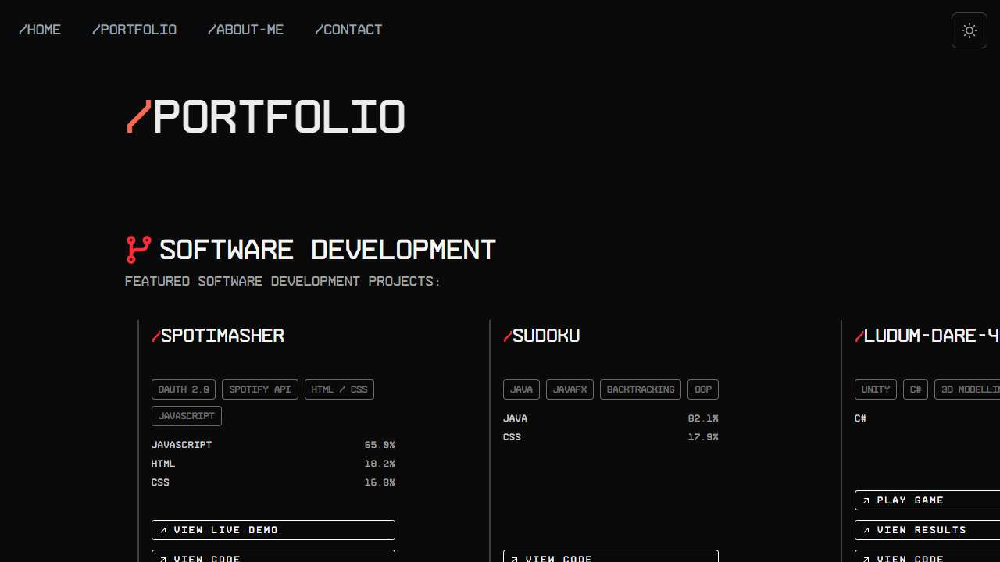
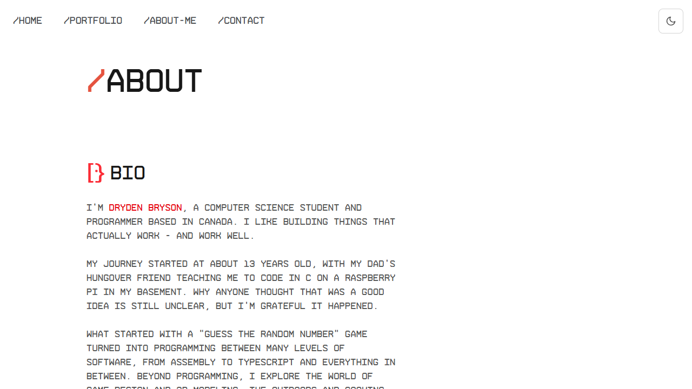

<div align="center">

# /dryd3n.ca

The personal portfolio of **Dryden Bryson**, a computer science student at the University of Victoria who builds software from assembly up to the web.

[**Visit the live site**](https://dryd3n.ca) &nbsp;|&nbsp; [GitHub](https://github.com/Dryd33n) &nbsp;|&nbsp; [LinkedIn](https://www.linkedin.com/in/drydenbryson/)



</div>

## The idea

The site is designed like a filesystem. Every page is a path (`/portfolio`, `/about-me`, `/contact`), menus open as directory trees (`├─ CODE`), and everything is set in a single monospace face. The home page is a terminal that won't sit still: a wall of characters glitches behind the name, and the name itself breaks apart when you hover over it.

It's dark by default, because that's how it was designed, with a light mode one click away.

## Highlights

| | |
|---|---|
| **Glitching character background** | A `<canvas>` grid of random characters that keep swapping and fading between colours, framed by a vignette. |
| **Fuzzy title** | The name is drawn on a canvas, and each row of pixels shifts sideways under the cursor, like a bad signal. |
| **Filesystem navigation** | Nav links blur in letter by letter (React Spring). Submenus unfold as `├─` trees, and their labels decrypt from scrambled characters. |
| **3D model viewer** | Blender models (`.glb`) open in an interactive React Three Fiber viewer where you can rotate, pan and zoom. |
| **Light and dark themes** | Dark by default whatever the OS is set to. Colours come from CSS variables, and switching crossfades the page with the View Transitions API. |
| **Working contact form** | A Next.js Server Action sends a formatted email through [Resend](https://resend.com), with the visitor's address set as reply-to. |
| **Separate phone layout** | The home page renders its own desktop or mobile layout depending on screen width, not just a squeezed version of the desktop one. |
| **Search engine metadata** | Per-page metadata, Open Graph images, JSON-LD structured data (Person, WebSite, ProfilePage), a sitemap, `robots.txt` and `llms.txt`. |

## Screenshots

<table>
  <tr>
    <td width="50%"></td>
    <td width="50%"></td>
  </tr>
  <tr>
    <td align="center">Home, light mode</td>
    <td align="center">Portfolio</td>
  </tr>
  <tr>
    <td width="50%"></td>
    <td width="50%"></td>
  </tr>
  <tr>
    <td align="center">About, light mode</td>
    <td align="center">Home, dark mode</td>
  </tr>
</table>

## Featured projects

These are the projects shown on the [portfolio page](https://dryd3n.ca/portfolio):

| Project | What it's built with | Links |
|---|---|---|
| **Batch PDF Export** (Obsidian plugin) | TypeScript, Obsidian API, esbuild | [Plugin](https://community.obsidian.md/plugins/batch-pdf-export) &nbsp; [Code](https://github.com/Dryd33n/obsidian-batch-pdf-export) |
| **D2L Scraper** | Python, Playwright, httpx | [Code](https://github.com/Dryd33n/d2l-scraper) |
| **Spotimasher** | JavaScript, Spotify Web API, OAuth 2.0 | [Live demo](https://spotimasher.web.app) &nbsp; [Code](https://github.com/Dryd33n/Spotimasher) |
| **Protectors of the Core** (Ludum Dare 46) | Unity, C#, 3D modelling | [Play](https://drydenexe.itch.io/protectorsofthecore) &nbsp; [Results](https://ldjam.com/events/ludum-dare/46/protectors-of-the-core) &nbsp; [Code](https://github.com/Dryd33n/Ludum-Dare-46) |
| **This site** | Next.js, React, TypeScript, Tailwind CSS | You're looking at it |

## Built with

| Area | Tools |
|---|---|
| Framework | [Next.js 15](https://nextjs.org) (App Router, Turbopack), [React 19](https://react.dev), TypeScript |
| Styling | [Tailwind CSS v4](https://tailwindcss.com), CSS custom properties, Arame Mono (self-hosted) |
| Theming | [next-themes](https://github.com/pacocoursey/next-themes), View Transitions API |
| Animation | [React Spring](https://www.react-spring.dev), [Framer Motion](https://motion.dev), HTML canvas |
| 3D | [three.js](https://threejs.org), [React Three Fiber](https://r3f.docs.pmnd.rs), [drei](https://drei.docs.pmnd.rs) |
| Email | [Resend](https://resend.com) through a Next.js Server Action |
| Hosting | [Vercel](https://vercel.com), with Vercel Analytics and Speed Insights |

## Project structure

```
app/
  page.tsx                  Home: picks the desktop or mobile layout
  portfolio/  about/  contact/
  components/
    backgrounds/            LetterGlitch canvas background
    global/                 Navbar, NavButton, PageHeader, DarkModeToggle, ThemeProvider
    home/                   DesktopHomePage, MobileHomePage
    portfolio/              ProjectCard, ModelCard, 3DViewer, ScrollingContainer
    skills/                 Scrolling logo gallery
    typography/             FuzzyText, DecryptedText
  hooks/                    ScreenWidthProvider, sendEmail (Server Action)
  globals.css               Theme tokens and base styles
lib/
  projectsData.ts           Project card content
  menuItems.ts              Navigation tree
  colorScheme.ts            Colours for the canvas components
  breakpoints.ts            Desktop/mobile breakpoint (1024px)
public/
  3D Models/                .glb files for the model viewer
  fonts/  icons/            Arame Mono and the skill/social SVGs
```

## Running it locally

You'll need [Node.js](https://nodejs.org) 18.18 or newer.

```bash
git clone https://github.com/Dryd33n/dryden-bryson.git
cd dryden-bryson
npm install
npm run dev
```

Then open [http://localhost:3000](http://localhost:3000).

Everything except the contact form works without any setup. To send email from the form, create a `.env.local` file in the project root:

```bash
RESEND_API_KEY=your_resend_api_key
```

The sender and recipient addresses are set in `app/hooks/sendEmail.ts`. The sender's domain has to be verified in your Resend account.

| Command | What it does |
|---|---|
| `npm run dev` | Start the development server with Turbopack |
| `npm run build` | Create a production build |
| `npm run start` | Serve the production build |
| `npm run lint` | Run ESLint |

## Making changes

- **Add a project:** define it in `lib/projectsData.ts`, then add it to the `softwareProjects` list in `app/portfolio/page.tsx`.
- **Add a 3D model:** put the `.glb` file in `public/3D Models/` and add a `ModelCard` to the portfolio page.
- **Change the colours:** edit the variables at the top of `app/globals.css`. The `:root` block is dark mode and `:root.light` is light mode. The canvas components can't read CSS variables, so their colours are kept in step in `lib/colorScheme.ts`.
- **Change the menus:** edit `lib/menuItems.ts`. The first item in each list is the top-level link, and the rest become its submenu.

## Deployment

The site deploys to [Vercel](https://vercel.com) from this repository. Add `RESEND_API_KEY` to the project's environment variables so the contact form works in production.

## Credits

Several animated components (FuzzyText, LetterGlitch, DecryptedText and TiltedCard) are adapted from [React Bits](https://reactbits.dev).

## Contact

Get in touch through the [contact form](https://dryd3n.ca/contact) or on [LinkedIn](https://www.linkedin.com/in/drydenbryson/).
